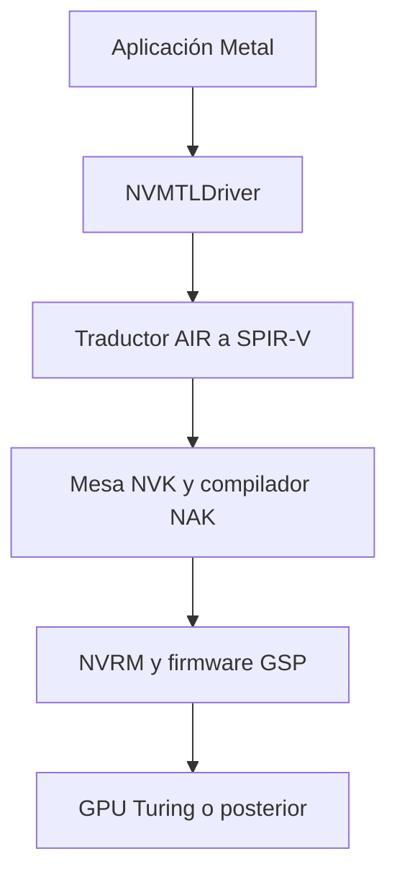

# Investigación de NullMoth para la GT 730

Revisión: 24 de octubre de 2026. Repositorio:
[nullmoth/nvidia-macos-driver](https://github.com/nullmoth/nvidia-macos-driver).
Versión examinada: `v2.5.4`, commit
`46779055f68208baa5ddfb9b2e9c77ed028e1d59`.

**Resultado:** el controlador examinado no es compatible con la GT 730 GK208B
(`10de:1287`, Kepler). No es una actualización directa de los controladores
Kepler restaurados por OCLP. Los parámetros específicos de sus kexts tampoco
constituyen optimizaciones demostradas para nuestra instalación actual.

## Método y alcance

Se aplicó el flujo de la habilidad `reverse-engineer-anything`: identificar el
objetivo, separar observaciones de inferencias y contrastar documentación con
código. Al tratarse de un repositorio con fuentes, la habilidad indica analizar
directamente esas fuentes en lugar de abrir un desensamblador o diagnosticar
proveedores REA sin una pregunta que dependa de un binario.

Se clonó una copia para lectura, fijó su commit, consultó el inventario de
releases y examinó soporte de tarjetas, instalación, arranque del kernel,
lectores de parámetros y estructura de compilación. No se ejecutaron el
instalador, kexts, aplicaciones ni pruebas GPU del proyecto. No se analizaron
los binarios publicados y no existen Evidence IDs de una sesión nativa REA.
Los identificadores de evidencia siguientes son referencias de esta revisión
de fuentes, no resultados de ejecución de REA.

## Compatibilidad observada

| Requisito | Equipo actual | Resultado |
| --- | --- | --- |
| CPU x86_64 | Intel i5-10400F | Coincide con la plataforma declarada |
| macOS Sequoia | 15.7.7 | Dentro del rango declarado por el proyecto |
| Arquitectura GPU | Kepler GK208B | Excluida del controlador GSP examinado |
| ID PCI | `1287` | Ausente de los 247 IDs del instalador |
| Criterio alternativo del instalador | `1287 < 1E00` | Tampoco permite esta tarjeta |

La comprobación de la tabla se hizo leyendo `SUPPORTED_IDS` del script como
texto y evaluando el ID conocido. No se ejecutó `install.sh` ni se simuló otra
GPU ante el sistema. El resultado estructurado está en
[research/nullmoth-gt730-compatibility.json](research/nullmoth-gt730-compatibility.json).

La personalidad IOKit de NVRM reconoce ampliamente dispositivos gráficos NVIDIA,
pero `NVRM::probe()` llama a `rm_is_supported_pci_device()` antes de aceptar la
tarjeta. Coincidir con el fabricante en Info.plist no demuestra soporte. Cambiar
la tabla de IDs no implementa el kernel, firmware y manejo de hardware que
Kepler necesitaría.

## Arquitectura del proyecto

La pila descrita y reflejada por la organización del código es:

NVRMFB proporciona el framebuffer, NVAccel la integración de aceleración e
IOSurface y NVRMAGDC parte de la política de pantalla. Estos componentes se
instalan en `/Library/Extensions` y se cargan mediante la colección auxiliar
del kernel. La instalación también añade un plugin Metal y sus bibliotecas.

Nuestro sistema usa actualmente otra pila: NVDAResman/NVDAGK100Hal, GeForce y
GeForceMTLDriver restaurados mediante parches Kepler de OCLP. No se identificó
una integración soportada entre ambas pilas para la GT 730.

El documento de soporte y NOTICE señalan NVIDIA 615.78.08; una etiqueta de
`HOW-IT-WORKS.md` aún menciona r610. Se conserva esta inconsistencia documental
en vez de tratar todas sus versiones descriptivas como equivalentes.

## Parámetros revisados

| Parámetro | Dónde se interpreta | Aplicabilidad actual |
| --- | --- | --- |
| `nvfb=1` | Framebuffer de NullMoth | No se estableció un equivalente en la pila Kepler actual |
| `nvaccel=1` | Acelerador de NullMoth | Habilita ese acelerador, no el GeForce actual |
| `nvfbheads` | NVRM | Configura cabezales de esa implementación |
| `nvrmsettle` | NVRM | Ajusta la espera de arranque de esa GPU/GSP |
| `-nvrmnoflip` | NVRM | Evita su ruta de presentación sin copia |

No hay evidencia de que añadir estos parámetros a nuestra EFI mejore la GT 730.
Tampoco deben trasladarse automáticamente los valores de BAR, bloqueo de
IONDRVSupport o configuración SIP/AMFI documentados para ese controlador.
Por ejemplo, el ajuste de BAR de su guía se describe como probado en una RTX
5060; no es una validación para nuestra tarjeta de 2 GB.

## Qué sí aporta a nuestra investigación

1. **Pruebas de imagen verificables:** validar píxeles de salida y propagar
   errores, además de comprobar que Metal crea un dispositivo.
2. **Seguimiento de estabilidad:** comparar informes nuevos, continuidad de
   WindowServer y eventos del kernel durante trabajo, inactividad y suspensión.
3. **Separación de fases:** diferenciar detección PCI, arranque del controlador,
   compilación de shaders, presentación y decodificación de vídeo.
4. **Recuperación y trazabilidad:** una configuración candidata separada,
   cambios pequeños y registro del hardware y commit de cada prueba.

Son ideas de metodología. No se trasladó código, no se portaron correcciones
de sincronización y no se atribuyeron a nuestro equipo los resultados de su
RTX 5060. El proyecto distingue tarjetas aceptadas de tarjetas validadas
físicamente; su matriz deja pendientes varias familias modernas.

## Decisión para este fork

La prioridad propuesta sigue siendo probar el bloqueo de `mediaanalysisd`
mediante RestrictEvents, conservando los parches Kepler existentes y el resto
de la EFI. El propietario indicó que no utiliza las funciones de Fotos o Live
Text afectadas. La preferencia queda registrada; esta investigación no aplicó
el cambio ni produjo una configuración de arranque modificada.

Después se compararán periodos equivalentes de uso y reposo. El criterio será
la evolución de informes GPU, síntomas visibles y pruebas Metal reproducibles;
no se promete un porcentaje de mejora. Los cierres de
`nsattributedstringagent` y la ausencia de decodificación de vídeo anunciada
por VideoToolbox siguen siendo problemas independientes por investigar.

No se propone portar NullMoth a Kepler como una optimización pequeña: la
documentación pide una implementación diferente para esas generaciones. La
viabilidad y esfuerzo de un port completo no quedaron establecidos.

## Registro de evidencia

Todos los enlaces de NullMoth se fijan al commit examinado.

| ID | Observación | Fuente y límite |
| --- | --- | --- |
| SRC-01 | Kepler está excluida; el soporte empieza en Turing | [CARD-SUPPORT.md](https://github.com/nullmoth/nvidia-macos-driver/blob/46779055f68208baa5ddfb9b2e9c77ed028e1d59/docs/CARD-SUPPORT.md#L3-L19); declaración de soporte |
| SRC-02 | `1287` no pasa la tabla ni el criterio alternativo | [install.sh](https://github.com/nullmoth/nvidia-macos-driver/blob/46779055f68208baa5ddfb9b2e9c77ed028e1d59/package/install.sh#L145-L167); evaluación estática |
| SRC-03 | El kernel consulta el filtro de NVIDIA | [NVRM.cpp](https://github.com/nullmoth/nvidia-macos-driver/blob/46779055f68208baa5ddfb9b2e9c77ed028e1d59/kexts/NVRM/NVRM.cpp#L384-L402); no se ejecutó el kernel |
| SRC-04 | El match IOKit amplio no elimina ese filtro | [Info.plist](https://github.com/nullmoth/nvidia-macos-driver/blob/46779055f68208baa5ddfb9b2e9c77ed028e1d59/kexts/NVRM/Info.plist#L51-L65) |
| SRC-05 | La ruta Metal depende de NVK, NVRM y GSP | [HOW-IT-WORKS.md](https://github.com/nullmoth/nvidia-macos-driver/blob/46779055f68208baa5ddfb9b2e9c77ed028e1d59/docs/HOW-IT-WORKS.md); análisis arquitectónico |
| SRC-06 | Los parámetros de NVRM pertenecen a ese controlador | [NVRM.cpp](https://github.com/nullmoth/nvidia-macos-driver/blob/46779055f68208baa5ddfb9b2e9c77ed028e1d59/kexts/NVRM/NVRM.cpp); lectores de argumentos, sin prueba de rendimiento local |
| SRC-07 | Parte de la compilación asume otro host y dependencias externas | [build_plugin_release.sh](https://github.com/nullmoth/nvidia-macos-driver/blob/46779055f68208baa5ddfb9b2e9c77ed028e1d59/build/build_plugin_release.sh); no se ejecutó SSH ni se compiló |
| SRC-08 | La licencia depende del componente | [LICENSE](https://github.com/nullmoth/nvidia-macos-driver/blob/46779055f68208baa5ddfb9b2e9c77ed028e1d59/LICENSE), [NOTICE](https://github.com/nullmoth/nvidia-macos-driver/blob/46779055f68208baa5ddfb9b2e9c77ed028e1d59/NOTICE), [README](https://github.com/nullmoth/nvidia-macos-driver/blob/46779055f68208baa5ddfb9b2e9c77ed028e1d59/README.md#license); raíz PolyForm Noncommercial, traductor LGPL, componentes externos con otras licencias; no se copió código |

## Cobertura y pendientes

- Compatibilidad de esta revisión con la GT 730: **respondida, no soportada**.
- Relación con la pila OCLP actual: **respondida a nivel de arquitectura**.
- Transferencia directa de los parámetros examinados: **sin evidencia de utilidad local**.
- Reproducción de su compilación y sus pruebas físicas: **no realizada**.
- Integridad o comportamiento de los binarios publicados: **no analizados**.
- Ganancia cuantitativa para nuestro equipo: **desconocida, requiere medición**.
- Viabilidad de un controlador nuevo para Kepler: **no establecida**.

Las búsquedas adicionales de issues por `Kepler`, `"GT 730"` y `mediaanalysisd`
fueron acotadas. No aportaron una implementación Kepler verificada que contradiga
la documentación; no constituyen una prueba de ausencia de todo trabajo futuro.
